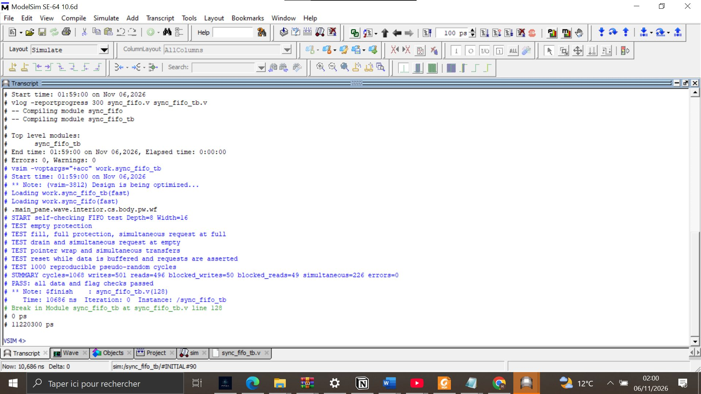
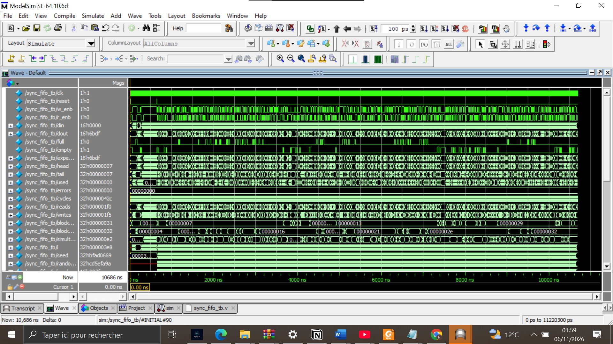
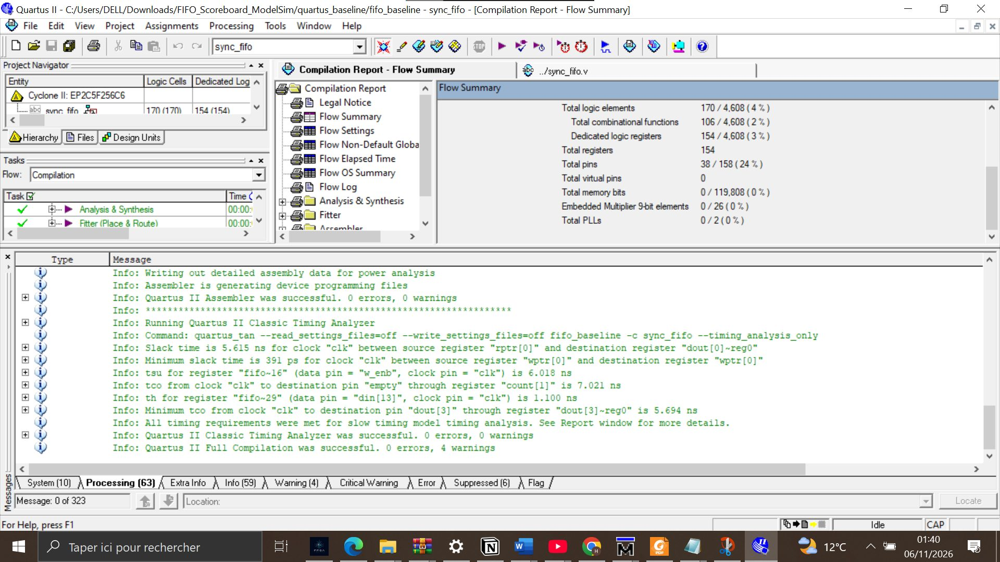
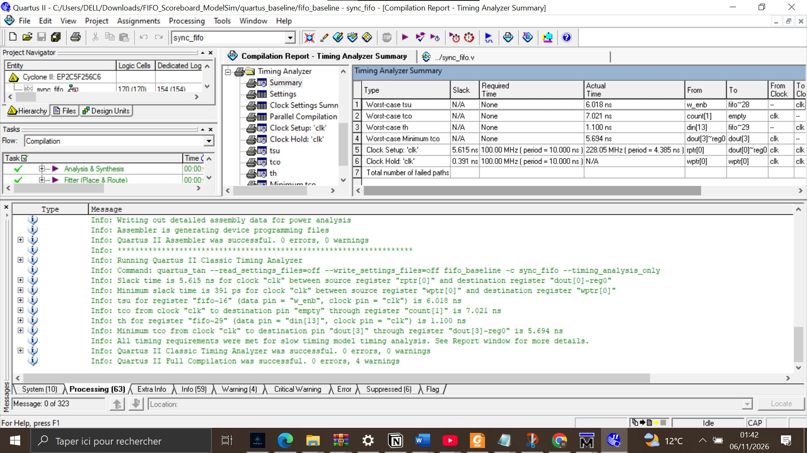

# Synchronous FIFO with scoreboard verification

Parameterized synchronous FIFO, adapted from Kranthi Uppada's MIT-licensed design:
https://github.com/kranthiuppada/synchronous-fifo
The original LICENSE is retained. This project extends the original RTL with scoreboard verification and compatibility improvements for Quartus II 9.0.

## Design
- Default depth: 8 words; width: 16 bits (128 data bits).
- One clock; asynchronous active-high reset; registered read output.
- Occupancy counter controls full/empty flags.
- Writes at full and reads at empty are rejected based on pre-edge occupancy, including simultaneous requests.
- Explicit pointer wrap supports positive non-power-of-two depths; only the default configuration is evidenced by the supplied results.
- Reset invalidates buffered data without clearing the memory array.

## Run in ModelSim
Change directory to this folder and enter:

```tcl
do run.do
```

The script compiles both files, loads sync_fifo_tb, configures onfinish AFTER loading the simulation, displays waves, and runs to completion. Expected marker:

```
PASS: all data and flag checks passed
```

The testbench checks data order, output hold, full/empty, rejected requests, simultaneous transfers, wrap, and reset with buffered data, followed by 1000 pseudo-random cycles and a final drain. This is plain Verilog with a reference-model scoreboard, NOT UVM. Transaction counters are NOT a coverage percentage.

## Verification and synthesis results
ModelSim SE-64 10.6d: the final package was compiled and simulated locally, with the corrected run.do, on 6 November 2026:
- 1068 cycles; 501 accepted writes; 496 accepted reads.
- 50 blocked writes; 49 blocked reads; 226 simultaneous accepted transfers.
- errors=0 and PASS; simulation time 10686 ns.
- The reset-with-data scenario explains why total writes and reads differ.

Quartus II 9.0 reports included under quartus_baseline:
- Cyclone II EP2C5F256C6; 170 LEs; 154 registers.
- 0 dedicated memory bits (storage implemented in logic/registers).
- Target 100 MHz; estimated internal-clock Fmax 228.05 MHz.
- Setup slack +5.615 ns; hold slack +0.391 ns.
- Full compilation successful, 0 errors, 4 remaining warnings.

## Visual results

### ModelSim: compilation and scoreboard PASS


### ModelSim waveforms


### Quartus resource usage


### Quartus timing analysis


## Quartus
Open quartus_baseline/fifo_baseline.qpf. The sync_fifo revision references ../sync_fifo.v. The testbench is not a synthesis source.

## Changes to the original RTL
- Replaced $clog2 with an elaboration-time function for older Quartus synthesis compatibility.
- Guarded pointer width for Depth=1.
- Replaced modulo pointer increments with explicit wrap.
- Sized increments/decrements to avoid the observed truncation warnings.
- Added a self-checking scoreboard testbench and a ModelSim run script.

## Limits
No physical-board validation is claimed. The four remaining warnings concern LogicLock licensing, pin locations, output capacitance and unused-pin configuration. Board pin assignments and appropriate I/O timing constraints must be supplied before hardware use. External I/O delays were not constrained; internal timing results are not complete interface timing sign-off. Fmax is an implementation estimate, not a measured hardware clock.

The final packaged run.do was checked in a fresh ModelSim run: compilation reported 0 errors and 0 warnings, and the scoreboard reported PASS. Quartus reports are included for reproducibility. No additional parameter configurations or physical hardware tests are claimed.
